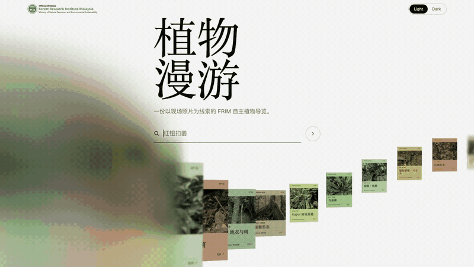
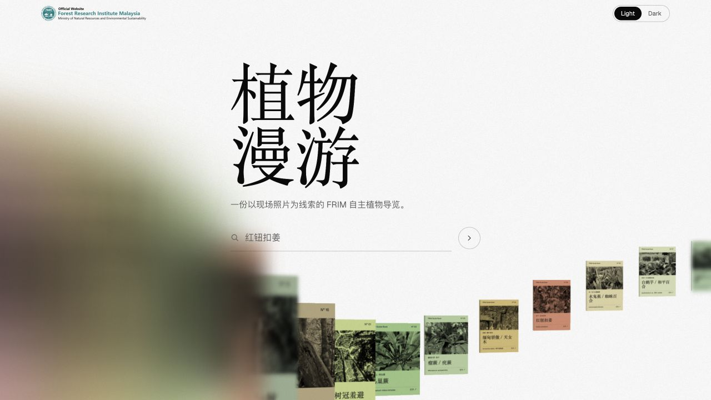
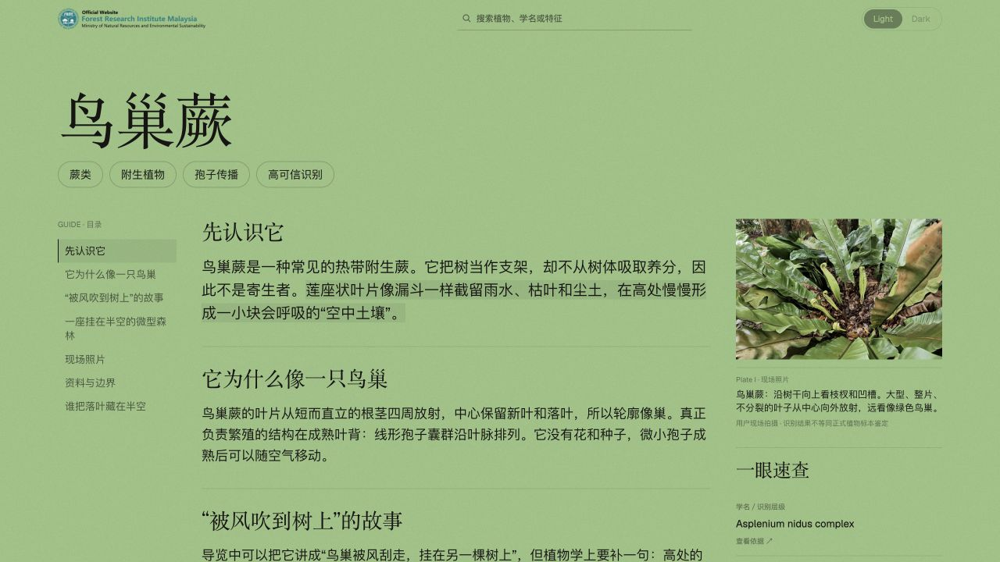
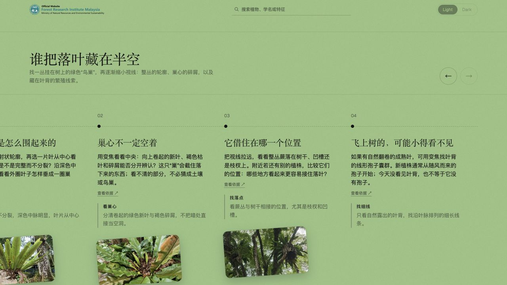

# Field Guidebook · 科普漫游

**把你的图片和文字，变成一本可以浏览、搜索、打开阅读的科普网站。**

这是一个包含完整网站模板的 Agent Skill。第一次调用时，Agent 先运行出下图的 FRIM 植物漫游网站，然后主动问你想做什么科普，邀请你提供更多照片和介绍文字，再把内容编排进去。



[查看 MP4 操作演示](docs/demo/demo.mp4) · [技能说明](SKILL.md) · [数据映射](references/content-map.md)

## 三步开始

### 1. 安装 Skill，用你习惯的 Agent

在终端运行：

```bash
npx skills add panggungunvibe/field-guidebook
```

按安装器提示选择 Agent。该命令使用 [Skills CLI](https://skills.sh/docs/cli)，会把 `SKILL.md` 与模板资源一起安装。Skill 采用通用文件格式，不绑定模型；可用于支持 Agent Skills 的 Codex、Claude Code、Cursor 等编程 Agent。

也可以下载完整仓库，让能读写本地文件、运行命令的 Agent 阅读 `SKILL.md`：

```bash
git clone https://github.com/panggungunvibe/field-guidebook.git
```

不要只复制提示词：`assets/`、`scripts/`、`references/` 都要保留。纯聊天模型若没有本地文件和命令能力，无法直接创建、启动这个网站。

### 2. 让它先完整复原网站

把这句话发给 Agent：

```text
使用 field-guidebook Skill，先把内置网站完整运行出来，
保留全部页面和交互，再问我想做哪方面的科普。
```

Agent 会从内置模板创建项目、安装依赖并启动预览。第一次看到的就是完整 FRIM 示例：16 个条目、28 张现场照片、不同的观察故事，以及现有书本画廊、搜索、打开／返回、图集和资料抽屉。

这里“完整复原”指随本 Skill 发布的网站版本；不需要 Agent 再凭图片猜结构，也不依赖参考站在线。安装只放置文件，首次调用才会启动网站。

### 3. 上传自己的照片和文字

网站运行后，Agent 会主动询问主题与受众。你可以这样回答：

```text
我想做一份给小学生看的昆虫科普。我会上传自己拍的照片，
有整体、侧面和细节图，还有几段介绍。
请按这些材料编排，每种昆虫有自己的故事和观察要领，
保留现在的网站交互，只替换内容。
```

材料可以分批提供：照片、对象名称、图注、已有介绍、参考资料或文件夹路径。多一些相关角度和细节会更好，但不必凑满 16 篇；一篇也可以先开始。Agent 会整理分类、封面、正文、图片说明、观察题和来源，再同步替换标题、品牌及搜索文案。

植物、动物、岩石、天文观察、博物馆展品都可以。不同对象应有不同讲法：看颜色、比光泽、追纹理、找结构，或解释一个名字；不会每篇都重复同一套观察步骤。

## 网站里有什么



- 连续移动的立体书本画廊，支持拖动、滚动和搜索过滤。
- 点书进入详情、返回书架的过渡动画。
- 阅读目录、正文、侧栏速查、照片图集和资料抽屉。
- 每册独特的观察题，照片可以独立拖动、点击放大。
- 相关书架、手机布局、键盘浏览和减少动画模式。

<details>
<summary>展开查看阅读与观察页面</summary>





</details>

## 运行环境与手动预览

需要 Node.js `^20.19.0 || >=22.12.0`、npm；初始化脚本使用 Python 3。首次安装依赖需要网络，网站本身没有 API Key、后端或账号要求，图片与字体随模板提供。

在仓库根目录运行：

```bash
python3 scripts/scaffold.py --dest ../my-guidebook
cd ../my-guidebook
npm ci
npm run dev -- --port 4174
```

打开 Vite 输出的本地地址。端口被占用时它会选择其他端口，以终端输出为准。

构建与内容检查：

```bash
npm run build
node ../field-guidebook/scripts/validate-content.mjs . --personalized
```

最后一条的脚本路径取决于仓库实际位置。默认示例会提示 FRIM 内容仍在，这是正常的；换主题后按提示检查残留内容。

## 为什么能保留网站效果

Skill 内置完整可运行模板，而非只有一段“请复刻网站”的提示词。初始化先核对文件哈希，拒绝覆盖已有项目；后续主要改三份数据文件：

| 文件 | 用途 |
| --- | --- |
| `site-config.js` | 品牌、标题、Logo、搜索与页面标签 |
| `plant-data.js` | 册页、正文、图集、引用和关联内容 |
| `plant-observations.js` | 各册不同的观察题、提示和配图 |

网站引擎留在模板中，常规内容更新不重写动画、几何方程或阅读方式。文件名保留 `plant-` 以兼容现有代码，内容不限植物。只有一册或没有 Logo 时也可运行，Logo 可退回文字标识。

## 项目结构

```text
field-guidebook/
├── SKILL.md
├── agents/openai.yaml
├── assets/
│   ├── site-template/          # 完整网站与示例素材
│   └── template-manifest.json  # 文件哈希
├── scripts/
│   ├── scaffold.py
│   └── validate-content.mjs
├── references/                # 内容映射、交互检查
└── docs/demo/                 # 实际网站录制与截图
```

## 来源与许可

网站视觉和交互参考 [Deimos by evilrabbit](https://deimos.evilrabbit.com/)，默认科普示例使用 [FRIM](https://www.frim.gov.my/) 场景。模板是独立制作的实现，不声称获得两者官方背书，也不承诺在所有设备与实时参考站像素一致。

Skill 指令、辅助脚本与本地网站代码使用 [MIT](LICENSE)。字体、FRIM 标识和作者现场照片的范围见 [素材说明](THIRD_PARTY_NOTICES.md)。原始私人云文档不随项目分发，示例提供本地照片图注索引。更换主题时使用自己的标识、照片与参考资料。
